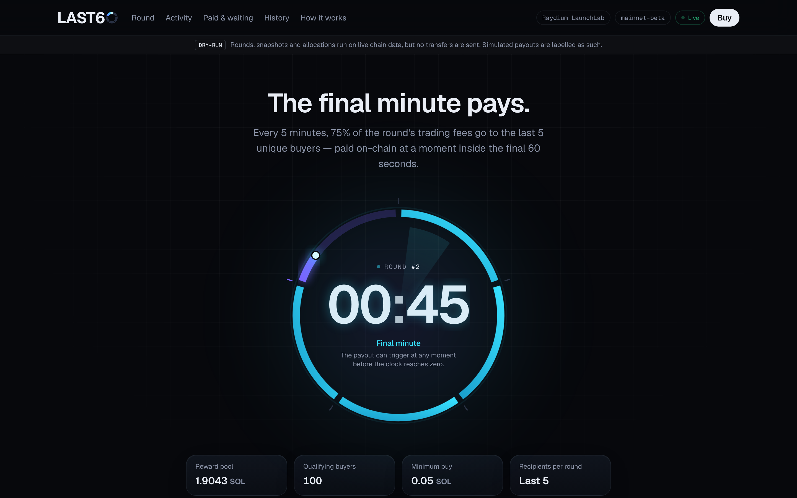

<p align="center"></p>

<p align="center"><b>The final minute pays.</b><br>
Every five minutes, 75% of a Solana token's eligible trading fees are paid on-chain to the five
most recent unique buyers — at a moment inside the final 60 seconds chosen by a secure random
draw and kept private until it happens.</p>

<p align="center"></p>

---

## What's in the box

| | |
|---|---|
| **Rewards engine** (`apps/worker` → `rewards`) | Clock-anchored 5-minute rounds; CSPRNG execution time sealed with AES-GCM and reused across restarts; snapshot at the cluster slot; deterministic unique-buyer selection; integer 75/25 allocation with dust and rollover; one MongoDB transaction per allocation; individual payouts with persisted-before-broadcast signatures and expiry-proven retries; reconciliation that halts on over-attribution. |
| **Indexer** (`apps/worker` → `indexer`) | WebSocket fast path + gap-free cursor polling + backfill; idempotent ingestion; finality tracking and fork exclusion; v1-transaction aware. |
| **Launch providers** | Meteora DBC and Raydium LaunchLab adapters from the official IDLs, validated on real mainnet data; switch with `LAUNCH_PROVIDER` (or live, from the admin console). |
| **API** (`apps/api`) | Public REST + Server-Sent Events from whitelisted DTOs; wallet-signature admin API with audited, version-checked configuration. |
| **Web** (`apps/web`, Next.js 16) | Countdown centerpiece with final-minute intensification, live reward pool, buyer feed, live engine terminal, payout history with Solscan links, stats and charts, admin console, brand page. |
| **Brand** (`brand/`) | LAST60 identity — logo (light/dark), icon, favicons, social image, X banner, OG image. |

## Quick start (local, no Docker)

```bash
bun install
bun run dev:mongo                     # MongoDB replica set on 127.0.0.1:27017
cp .env.example .env                  # then edit — see below
bun run cli check-config              # validates every process role
bun run dev:indexer & bun run dev:rewards & bun run dev:api & bun run dev:web
open http://localhost:3000
```

Minimum `.env` for a **read-only run against a real pool** (payouts are dry-run by default):

```bash
SOLANA_CLUSTER=mainnet-beta
SOLANA_RPC_URL=https://mainnet.helius-rpc.com/?api-key=…
LAUNCH_PROVIDER=raydium_launchlab            # or meteora_dbc
TOKEN_MINT=…  POOL_ADDRESS=…  FEE_BENEFICIARY_ROLE=creator
MONGODB_URI='mongodb://127.0.0.1:27017/?replicaSet=rs0&directConnection=true'
SCHEDULE_ENCRYPTION_KEY=$(bun run cli gen-schedule-key)
PAYOUT_WALLET_PUBLIC_KEY=<payout wallet address>
INDEXER_BACKFILL=none
```
`bun scripts/find-active-pool.ts raydium_launchlab` prints a busy pool to try.

## Tests

```bash
bun run test        # 109 tests: real MongoDB replica set, fault-injecting chain, real Solana runtime (LiteSVM),
                    # real mainnet transaction fixtures — no network, no real keys
bun run typecheck
```

## Verify the engine against the chain

```bash
bun run verify:fees meteora_dbc <pool> <mint> creator     # full-history attribution == on-chain counters
bun run verify:round <n> --fees                           # re-derive a round's recipients & fees from public data
```

## Documentation

| | |
|---|---|
| [Architecture](docs/ARCHITECTURE.md) | processes, rounds, snapshot, payouts, privacy, failure handling |
| [Fee accounting](docs/FEE_ACCOUNTING.md) | formulas, periods, ledger, collection, reconciliation |
| [Providers](docs/PROVIDERS.md) | Meteora DBC & Raydium LaunchLab internals, switching, **post-migration requirement** |
| [Database](docs/DATABASE.md) | collections, constraints, state machines, reconstruction |
| [API](docs/API.md) | public, SSE and admin endpoints |
| [Security](docs/SECURITY.md) | keys, money-movement invariants, schedule privacy, admin |
| [Deployment](docs/DEPLOYMENT.md) | build, env split, PM2, reverse proxy, go-live sequence |
| [Operations](docs/OPERATIONS.md) | runbook |
| [Brand](docs/BRAND.md) | name exploration, identity, assets |
| [Verification](docs/VERIFICATION.md) | what was proven, evidence, and what is not done |
| [Audit](docs/AUDIT.md) | production-readiness audit: confirmed issues, fixes, risks, blockers |

## Acceptance criteria — status

| # | Criterion | Status |
|---|---|---|
| 1 | Token mint and pool configurable | ✔ env or admin console (validated against chain on load) |
| 2 | Monitors real qualifying Solana buys | ✔ ran on mainnet (Meteora DBC and Raydium LaunchLab pools) |
| 3 | Unique buyer tracking | ✔ tests + chain-verified recipients for every live round |
| 4 | Independent five-minute rounds | ✔ clock-anchored; runs without API/web |
| 5 | Random execution time survives restarts | ✔ sealed, CAS-persisted, tested; workers restarted mid-run |
| 6 | Accurate eligible-fee accounting | ✔ exact full-history reconciliation on two real DBC pools; live rounds match the chain to the lamport |
| 7 | 75% distribution calculated correctly | ✔ integer math, property-tested, chain-verified |
| 8 | Individual payouts executed and verified | ✔ on the real Solana runtime (LiteSVM) and fault-injection suite; **live mainnet transfers not sent (not authorized)** |
| 9 | Failed payouts recoverable safely | ✔ expiry-proven retries, max attempts → requeue, tested |
| 10 | Real-time dashboard | ✔ SSE, server-clock-synced countdown |
| 11 | Payout history with verified transactions | ✔ signatures shown only once final, Solscan links (dry-run rounds labelled) |
| 12 | Terminal shows actual worker activity | ✔ every line is a real backend event |
| 13 | Scheduling information stays private | ✔ not in any public response, terminal line, log or admin endpoint (tested) |
| 14 | Provider switch by configuration only | ✔ performed live via the admin API |
| 15 | Runs without the frontend | ✔ separate processes |

**Before going live:** implement the post-migration adapter (DAMM v2 / Raydium AMM-CPMM) — bonding
pools graduate quickly — and follow the go-live sequence in [Deployment](docs/DEPLOYMENT.md).
Live mainnet payouts require `PAYOUT_MODE=live` **and** `ALLOW_MAINNET_PAYOUTS=true`.

## Layout

```
apps/
  api/        Hono API (public REST, SSE, admin)
  web/        Next.js 16 dashboard, admin console, brand page
  worker/     indexer, rewards and CLI entrypoints
packages/
  engine/     config, db, chain, providers, indexer, rewards, terminal (server-only)
  shared/     DTOs and exact amount formatting (browser-safe)
brand/        identity assets
scripts/      fixtures, brand rendering, verification and screenshot tools
docs/         documentation, evidence, screenshots
```
